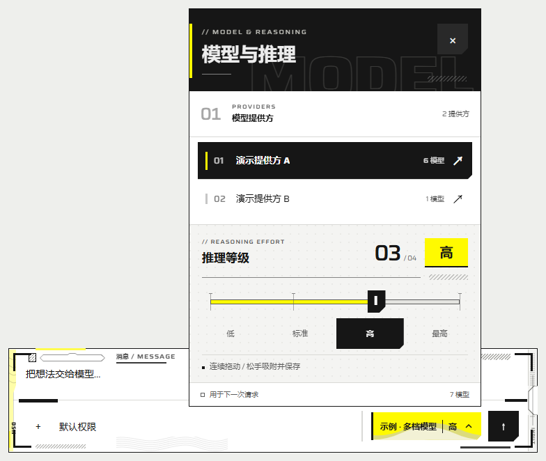

# DSH 终末地推理滑条

> 给 [DeepSeek Harness](https://github.com/deepseek-ai/deepseek-harness)（DSH）用的 **终末地风格模型与推理等级选择器**。
> 从输入框上的一枚模型按钮，打开提供方、模型列表和推理滑条，搭配工业面板排版、粒子转场与通行证风格输入框。

适用于 **Windows 桌面浏览器中的 DSH Web**，默认安装到 `web` profile。DSH Desktop 专用 profile 尚未验证。

[](https://github.com/hanagasakugoro-blip/dsh-endfield-slider/releases/tag/v0.8.2)


[](LICENSE)



截图由本项目客户端在独立预览页实际渲染，使用演示模型目录。安装到 DSH 后，模型名称与推理档位来自宿主。

**[下载最新版本](https://github.com/hanagasakugoro-blip/dsh-endfield-slider/releases/latest)** · [安装说明](#安装) · [使用方法](#使用) · [问题反馈](https://github.com/hanagasakugoro-blip/dsh-endfield-slider/issues)

## 目录

- [功能](#功能)
- [安装](#安装)
- [使用](#使用)
- [升级与卸载](#升级与卸载)
- [兼容性与已知限制](#兼容性与已知限制)
- [常见问题](#常见问题)
- [开发与预览](#开发与预览)
- [打包](#打包)
- [项目结构](#项目结构)
- [文档](#文档)
- [致谢与许可](#致谢与许可)

## 功能

### 模型与推理等级

- **一个入口**：替换输入区的模型按钮，在同一个面板中浏览提供方、搜索模型、调整推理等级。
- **档位来自宿主**：名称和取值以模型的推理元数据为准；宿主未声明默认强度时，额外提供“提供方默认”选项，将强度选择交给宿主。没有推理元数据的模型仍可选择，不显示可调滑条。
- **连续跟手**：拖动时滑块可停在任意两档之间，松手吸附到最近档位并保存；点击档位时平滑移动到目标位置。
- **逐模型记忆**：以提供方和模型的组合作为标识。首次打开保留 DSH 当前设置；切回已使用的模型时恢复有效记忆，切换到未记录的模型时采用宿主默认设置。
- **保存有反馈**：区分预览、保存中、保存成功与失败。宿主确认成功后才更新记忆，失败时提示原因并恢复宿主值。

### 终末地风格界面

- **工业面板排版**：荧黄、黑白块面、细线分区、切角按钮，配合列表编号与当前档位计数。
- **模型按钮混色**：荧黄与米白／浅灰波浪动态混合，悬停和展开时渐显。
- **面板开合**：打开时黑黄块从左向右覆盖，再伴随像素块和网点擦除；关闭时像素横条错层向右拉长并淡出。
- **选中确认**：切换成功时短促闪烁与震颤，让操作结果更明确。
- **输入框装饰**：细侧带、挂孔、刻线和等高线呼应通行证元素；悬停、聚焦与发送具有对应反馈。
- **深浅主题与减少动态效果**：跟随 DSH 主题；系统启用“减少动态效果”时关闭动画，保留静态布局和操作状态。

## 安装

### 前置条件

| 项目 | 要求 |
| --- | --- |
| DSH | 已安装并初始化过 Web profile；已验证版本为 **0.2.1-rc.2** |
| 平台 | Windows 桌面端 |
| Node.js | **22 或更高版本**，用于执行安装／卸载脚本 |
| 构建 | 运行包已包含客户端产物，安装时无需 `npm install` 或重新构建 |

### 下载运行包

打开 [Releases](https://github.com/hanagasakugoro-blip/dsh-endfield-slider/releases)，下载运行包：

**[dsh-endfield-reasoning-slider-0.8.2.zip](https://github.com/hanagasakugoro-blip/dsh-endfield-slider/releases/download/v0.8.2/dsh-endfield-reasoning-slider-0.8.2.zip)**

将其解压到准备长期保留的目录。`-source.zip` 是开发源码包；普通安装使用上面的运行包。

需要核对下载文件时，在 ZIP 所在目录运行下面的 PowerShell 命令，并将结果与同一 Release 中的 `SHA256SUMS.txt` 对照：

```powershell
Get-FileHash .\dsh-endfield-reasoning-slider-0.8.2.zip -Algorithm SHA256
```

### 安装到 Web profile

以下双击脚本使用默认 Web profile；自定义目录请使用后面的 Node.js 命令。

1. 在解压后的目录双击 **`install.cmd`**。
2. 等待脚本执行结束。成功时窗口可能直接关闭，可按后面的步骤验证；需要查看完整输出时使用 PowerShell 命令。
3. 刷新 DSH Web；如果宿主仍未加载插件，再重启 DSH。
4. 点击输入框上的模型按钮，确认出现“模型与推理”面板。

也可以在解压目录的 PowerShell 中执行：

```powershell
node scripts/install-profile.mjs
```

默认目标为当前用户主目录下的 **`.dsh/profiles/web`**。使用自定义 Web profile 时，显式传入路径：

```powershell
node scripts/install-profile.mjs --profile-path "你的 Web profile 完整路径"
```

`install.cmd` 和 `uninstall.cmd` 不转发命令行参数；自定义 profile 请直接运行 `node scripts/install-profile.mjs` 并传入 `--profile-path`。

安装器会备份 profile 配置，添加本插件的 `link:` 依赖和 bundle，再创建目录链接并校验。其他插件、皮肤条目和配置会保留，备份位于插件目录的 `backups/`。

**安装后请保留插件目录及其位置。** DSH 通过该目录链接加载插件，直接移动或删除目录会影响加载。

## 使用

输入区的按钮显示当前模型与推理等级；点击后，上半部分用于选择提供方和模型，下半部分用于调整当前模型的推理等级。

| 操作 | 结果 |
| --- | --- |
| 点击模型按钮 | 打开／关闭面板 |
| 点击提供方 | 进入该提供方的模型列表，可搜索模型 |
| 点击模型 | 切换模型，并恢复有效记忆或采用宿主默认档位 |
| 拖动滑条 | 连续预览位置，松手吸附最近档位并保存一次 |
| 轻点轨道 | 平滑移向点击位置，松手后保存最近档位 |
| 点击档位文字 | 立即提交该档位，滑块平滑移到对应位置 |
| 滑条聚焦后按方向键、`Home`／`End`、`PageUp`／`PageDown` | 调整预览，松开按键后保存 |
| `Escape` | 依次取消未提交预览、返回提供方列表、关闭面板 |
| `Tab`／`Shift+Tab` | 在面板控件间切换焦点 |
| 点击面板外 | 关闭面板 |

拖动期间不连续写入宿主，取消拖动或取消键盘预览不会保存。设置用于**下一次请求**，正在执行的请求沿用宿主规则。

输入框的发送确认表示已发起发送操作，服务端结果仍由 DSH 展示。原有鼠标发送、快捷键、停止按钮和禁用状态保留。

## 升级与卸载

### 升级

默认 Web profile：

1. 在旧插件目录运行 `uninstall.cmd`。
2. 将新版运行包解压到准备保留的目录，再运行其中的 `install.cmd`。
3. 刷新 DSH Web；必要时重启 DSH。

自定义 Web profile 请使用以下命令，将占位内容替换为实际绝对路径；卸载和安装的 profile 路径必须相同：

```powershell
node "<旧插件目录>/scripts/install-profile.mjs" --uninstall --profile-path "<Web profile 完整路径>"
node "<新插件目录>/scripts/install-profile.mjs" --profile-path "<Web profile 完整路径>"
```

同一浏览器来源下保存的模型记忆可继续使用。

### 卸载

在当时安装的插件目录双击 **`uninstall.cmd`**，或执行：

```powershell
node scripts/install-profile.mjs --uninstall
```

自定义 profile 的卸载命令：

```powershell
node scripts/install-profile.mjs --uninstall --profile-path "你的 Web profile 完整路径"
```

卸载器只移除本插件的依赖、bundle 和已验证的目录链接。刷新 DSH 后，本插件不再接管模型入口，其他皮肤和插件保留。

## 兼容性与已知限制

| 项目 | 说明 |
| --- | --- |
| 已验证宿主 | DSH Web **0.2.1-rc.2**；其他版本尚未确认 |
| 已验证平台 | Windows 桌面端 |
| 默认 profile | `web`；DSH Desktop 专用 profile 尚未验证 |
| 主题 | 跟随 DSH 的深浅主题 |
| 运行时依赖 | React 由 DSH 提供，客户端和字体已打包，安装时不需额外下载 npm 依赖 |
| 模型与档位 | 读取宿主目录与推理元数据；“提供方默认”表示让宿主决定强度 |
| 设置作用范围 | 下一次请求；逐模型记忆保存在浏览器当前来源的 localStorage |

- 本插件接管 `conversation.input.model` 单槽，原模型按钮入口由本插件面板替代；同时替换该位置的其他选择器可能与它冲突。
- 样式集中在输入区域和本插件面板。其他皮肤若修改相同区域，仍可能产生覆盖差异。
- 同一浏览器来源下的会话共享逐模型记忆；不同浏览器、域名或端口之间不共享。
- DSH 的内部接口或输入框结构变化后，可能需要更新插件。
- 项目与鹰角网络、《明日方舟：终末地》无官方关联，不包含游戏素材、标志或官方字体。

## 常见问题

### 安装时提示找不到 profile，怎么办？

先确认已运行并初始化 DSH Web。脚本默认寻找当前用户的 `.dsh/profiles/web`；使用其他目录时传入 `--profile-path`。安装器需要目标目录中存在有效的 DSH profile 配置。

### 安装成功，还是原来的模型按钮？

确认安装的是当前 DSH 实际使用的 Web profile，再刷新页面；必要时重启 DSH。若已安装另一个模型选择器，也需要检查它是否占用了同一个模型槽位。

### 安装器提示已有其他位置的插件，怎么办？

先从原安装目录卸载，再安装新目录中的版本。安装器会检查链接归属，避免覆盖已有安装。

### 模型列表为空，或者某个提供方加载失败？

模型目录来自 DSH。先检查宿主中的提供方、账号和模型配置，并查看面板中的加载状态或错误提示。反馈问题时附上 DSH 版本与复现步骤，隐藏访问 token 和账号凭据。

### 为什么某个模型没有推理滑条，或者档位数量不同？

可调档位由当前模型的元数据决定。模型未提供推理元数据时不显示可调滑条；只有一个有效选项时无法继续调节。宿主未声明默认强度时，界面会额外提供“提供方默认”；选择它时会省略 `reasoningEffort`，由宿主决定强度，因此界面选项数可能比显式档位数多一个。

### 切换模型后，推理等级如何确定？

首次打开面板时保留 DSH 当前设置。切换模型时优先恢复该提供方和模型的有效记忆；没有有效记忆时使用宿主默认设置。每个模型分别记录。

### 如何清空模型记忆？

在实际使用的 DSH 页面打开浏览器开发者工具，执行：

```js
localStorage.removeItem('dsh.endfield.reasoning.v1')
```

随后刷新页面。正常卸载会保留这份记忆，方便重装。

### 可以关闭动画吗？

在系统辅助功能设置中启用“减少动态效果”。插件会停止动画并保留静态界面与完整操作功能。

## 开发与预览

请使用仓库源码，或下载 [0.8.2 开发源码包](https://github.com/hanagasakugoro-blip/dsh-endfield-slider/releases/download/v0.8.2/dsh-endfield-reasoning-slider-0.8.2-source.zip) 并解压。运行包不含完整开发文件，不能用于以下预览流程。

打开 PowerShell，进入包含 `package.json`、`package-lock.json` 和 `src/` 的源码根目录，再执行：

```powershell
npm ci
npm run build
npm run preview
```

上述命令会在你自己的电脑上启动本地预览服务。保持终端运行，再用同一台电脑的浏览器打开 `http://127.0.0.1:3086/`。

**这是本地开发地址，不是在线演示链接。** 其他人需要先获取源码并运行上述命令，才能在各自电脑上预览。预览使用模拟宿主和演示模型；真实 DSH 的目录读取与参数写回需在宿主中验证。

开发依赖为 React、React DOM 和 Playwright。预览可选读取当前用户已安装的 maid 皮肤样式，未安装该皮肤也可使用。

首次 `npm ci` 通常需要联网下载开发依赖。预览的输入框外观可能因本机是否加载其他皮肤而与截图不同。

如果启动时提示端口已被占用，可在 PowerShell 中指定其他端口：

```powershell
$env:PORT = '3087'
npm run preview
```

随后在同一台电脑打开终端打印的地址，例如 `http://127.0.0.1:3087/`。

```powershell
npm test                 # 核心与隔离安装器检查，12 项，不调用模型
```

可选的宿主契约检查需要本机安装相应版本的 DSH。先将下方路径替换为其实际的 `node_modules/@deepseek-ai` 目录，再运行：

```powershell
$env:DSH_EF_HOST_MODULES = '<DSH 安装目录>/node_modules/@deepseek-ai'
npm run test:contract
```

已有浏览器专项脚本需要本机 Google Chrome；相关依赖加载见 `scripts/dev-runtime.mjs`，预览端口设置见 `scripts/preview-server.mjs`。

`npm run build` 将 `src/` 模块、局部 CSS 和 Saira 字体合并为 `lib/client.js`。修改源码后重新构建，再刷新或重启宿主加载。

## 打包

```powershell
npm run build
npm run pack:local
```

产物输出到 `dist/`：

| 文件 | 用途 |
| --- | --- |
| `dsh-endfield-reasoning-slider-<版本>.zip` | 运行包，包含构建客户端、安装／卸载脚本与许可文件 |
| `dsh-endfield-reasoning-slider-<版本>-source.zip` | 开发源码包，包含源码、锁文件、测试、预览和文档 |
| `SHA256SUMS.txt` | 两个 ZIP 的 SHA-256 校验值 |

## 项目结构

```text
src/                       模型目录接入、面板、滑条、动效与输入框源码
lib/                       DSH 插件入口与构建后的客户端
scripts/                   构建、安装、卸载、打包与预览服务
preview/                   模拟宿主与独立交互预览页
test/                      核心、安装器、宿主契约与浏览器专项检查
assets/                    Saira 字体及其许可证
docs/                      桌面截图、发布说明与准备记录
cordis.patch.yml           插件组合层声明
install.cmd                默认 Web profile 安装入口
uninstall.cmd              默认 Web profile 卸载入口
```

## 文档

| 文档 | 内容 |
| --- | --- |
| [CHANGELOG.md](CHANGELOG.md) | 版本变化 |
| [VALIDATION.md](VALIDATION.md) | 已验证范围、环境与已知限制 |
| [发布准备记录](docs/release-preparation.md) | 0.8.2 构建、12 项核心／安装器检查及桌面预览结果 |
| [THIRD_PARTY_NOTICES.md](THIRD_PARTY_NOTICES.md) | 参考实现、字体与第三方许可说明 |

## 致谢与许可

- 目标宿主：[deepseek-ai/deepseek-harness](https://github.com/deepseek-ai/deepseek-harness)。
- 模型目录与槽位接入参考：[Bai-2008/a-better-dsh-codex-effort-slider](https://github.com/Bai-2008/a-better-dsh-codex-effort-slider)，相关上游版权声明已保留。
- README 的章节组织与操作说明参考上述项目及 [ABING1111/dsh-codex-model-effort-selector](https://github.com/ABING1111/dsh-codex-model-effort-selector)。
- 代码采用 [MIT License](LICENSE)；Saira 字体采用 [SIL Open Font License 1.1](assets/Saira-OFL.txt)。
